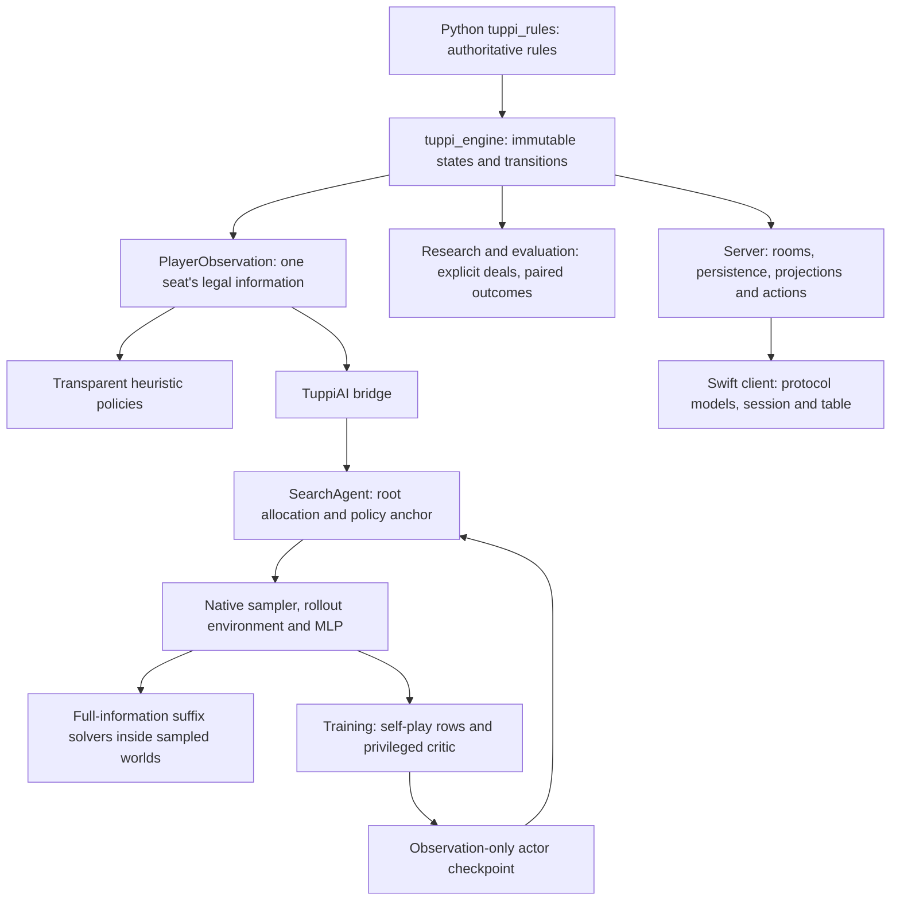

# Architecture and source field guide

Companion to [REPORT.md](REPORT.md). Source paths below describe the inspected workspace; hashes and checkout identities are recorded in the snapshots.

## Layering

Core rules/engine packages do not need Torch. The server consumes engine actions and projections. Research may see full state to label or check outcomes, but a playing actor receives only its legal view. This is an API discipline and tested dependency boundary, not an OS sandbox against arbitrary hostile Python.

## Reference engine and rules

| Package in `TuppiProject-current/src` | Responsibility | Principal entry points |
|---|---|---|
| `tuppi_rules` | Cards, shows/fallbacks, legal tricks, RAMI/NOLO/sooli scoring and rising score | Public rules exports; rule configs in `configs/rules` |
| `tuppi_engine` | Explicit private deal state, accepted transitions, immutable observations/events/results | `create_match`, `begin_explicit_deal`, `apply_match_action`, `match_observation_for` |
| `tuppi_agents` | Transparent deterministic heuristic ladder and registries | `factory.py`, `profiles.py`, `improved_registry.py`, `showing.py`, `partner_aware.py`, `refined_play.py` |
| `tuppi_eval` | Banks, balanced schedules, arena, agent identities, summaries | `arena.py`, `schedules.py`, `statistics.py`, `qualification.py` |
| `tuppi_match` | Complementary complete-match legs, frozen streams, bank separation | `executor.py`, `protocol.py`, `banks.py`, `statistics.py` |
| `tuppi_exact` | Hard constraints, feasible counts, exact uniform samples, legal hypothetical continuations, exact solving | `constraints.py`, `counting.py`, `sampling.py`, `continuation.py`, `solver.py` |
| `tuppi_search` | PIMC, root information UCT, multi-observer redeterminization and diagnostic oracles | `pimc.py`, `root_info_uct.py`, `multi_observer.py`, `fast_trick.py` |
| `tuppi_belief` | Historical causal action-likelihood posterior | Existing belief documentation and package source |
| `tuppi_learning` | Historical imitation/CTDE preparation | `models.py`, `encoding.py`, `imitation.py`, `checkpoints.py` |
| `tuppi_research` | Programme proposals, cycles, decisions and ledger | `runner.py`, `cycle.py`, `ledger.py` |
| `tuppi_server`, `tuppi_ui_fixtures` | Product transport and canonical client fixtures | See product section below |

`project_target_v1` is the original ordinary game; v2 adds sooli; v3 adds blind locked bids. Preserve these identifiers for recorded experiments. In the reference engine, bid collection can stop at the first RAMI while observations hide earlier bids. The live server collects human locks together and applies them in reveal order, discarding later unseen bids. This distinction is documented in [v3 rules](../../TuppiProject-current/docs/rules/project_target_v3.md), not a justification to inspect hidden bids during a bot decision.

`PlayerObservation` includes own hand, public histories, legal actions, score, dealer and ruleset. Exchanged cards are private to the soolaaja and partner. Bidding observations hide locked bid cards. Nonacting seats have no legal-action list. The bridge reads these fields, not a private `DealState`.

`trusted_transitions()` is a scoped research-generation optimization in [trusted.py](../../TuppiProject-current/src/tuppi_engine/trusted.py). It skips selected implicit revalidations, preserves explicit validators and start/end boundaries, and uses a `ContextVar`. Its documented contract requires differential tests and explicit sampled output checks. It is already used by the main evaluators. It should not be proposed as a new universal speed switch or used to bypass product validation.

## Current bot decision flow

1. `best_agents()` loads rollout clone, own-team rollout actor, anchor actor and equity table. Each seat gets a separate mutable controller/search environment and seed mapping.
2. `SearchAgent.choose_action()` returns a forced action directly. Otherwise `bridge.obs_from_player_observation()` constructs a native `TcObs` and maps legal engine actions into native IDs.
3. Sooli decisions use `_sooli_action()`. Offers compare accept and decline with an offer margin; gives/play search with configured tie order; returns use the heuristic. This path has different semantics from ordinary policy anchoring.
4. Ordinary showing/play uses fixed or adaptive sampled-world pricing. E7 prices current contenders on shared batches, eliminates confidently worse choices, and can stop at a practical delta. Per-action means after elimination can represent unequal sample counts.
5. `_keep_blueprint()` applies the policy anchor after pricing. With `keep=None`, search chooses directly. With keep enabled, the anchor's legal argmax remains unless beaten by the margin.
6. Engine action objects remain the authority. Native IDs are converted back by selecting from the original legal actions; the server/runner applies the action through the engine.

Uniform hard-feasible sampling ignores most behavioral inference. Sooli's offer-prefilter/tilt is an explicit exception; optional belief-search settings are separate research arms. Determinization can still fuse mutually incompatible strategies across hidden worlds. A full-information suffix result is a rollout evaluation, not an imperfect-information security certificate.

## Native contracts

| File in `TuppiAI/native` | Role |
|---|---|
| `tuppi_core.c/.h` | Bitboard state machine, rules, scoring, legal masks and observation encoders |
| `tuppi_search.c`, `showing_constraints.h` | Hard-feasible world sampling; suit DP/cache; ordinary showing-fallback restriction repair; exchanged-card sooli sampling |
| `tuppi_env.c` | Batched games, equity rewards, native root rollouts, per-world values, self-play/label/PPO row export |
| `tuppi_mlp.c/.h` | CPU inference, active-feature first layer and Accelerate dense layers |
| `tuppi_dd.c` | Contract-polarity four-player late-game minimax with canonical positions and transposition bounds |
| `tuppi_sooli.c` | Three-player ace-low sooli survival solver; budgeted offer probes |
| `tuppi_sooli_policy.c` | Observation-based offer/exchange/play heuristics |
| `native/research` | Isolated patched build, explicit-world tracing and research API; not the live library |

Cards are `suit * 13 + rank - 2`, suits hearts/diamonds/clubs/spades. Actions 0–51 play a card; 52–103 show NOLO; 104–155 show RAMI; 156/157 decline/accept sooli; 158–209 exchange a card. The native bridge has 210-action legal buffers but ordinary models have 156 outputs. The latest ordinary encoder is 1,951 binary features; the earlier encoder is 1,223.

`native.py` loads a concrete `native/libtuppi.dylib` and checks `TcDeal`/`TcObs` sizes. Equal struct sizes do not attest binary/source identity. Its `Env` owns a native pointer plus NumPy buffers; `Mlp` owns copied native weights; destructor methods free those pointers. Environments retain references to attached model wrappers so their native pointers remain alive. A research library must own objects from its own build; `research/native_api.py` provides that separation.

Global settings include sampler fixing, extra NOLO tail depth, rollout chunk, native parallel loops, branch sharing and the offer-model pointer. Sooli/value/team-rollout settings live on environments. Solver/DP caches are thread local. A copied controller must capture every persistent setting and RNG; copying only model weights does not fork a policy.

The live build uses macOS dispatch and Accelerate. Portability to another platform is not established by Python AST checks. No native library was built or loaded during this review.

## Learning systems

`train.py` is deep Monte Carlo: terminal per-deal equity labels for selected actions, a replay buffer and a shared Q network. `selfplay.py` is approximate policy iteration: record full states under the current policy, branch-price legal actions under that continuation, train centered action differences, choose conservative improvements, and distill a small playing policy. Its data packs binary features, legal action IDs and fp16 values. Larger Q models can be used for fitting while a smaller model serves rollouts.

`vrpo.py` collects native stochastic policy trajectories. The actor receives observation features and legal masks. The privileged Q critic additionally receives the three other hands in relative order. It forms expected policy values, sign-corrected temporal residuals and Q-boosted advantages; critic targets and advantages are held fixed during PPO updates. Sooli is played by the fixed controller inside the environment. Its episode is **one deal**, with terminal reward from the incumbent equity surrogate; this differs from the returned proposal for complete-match learning and match-boundary bootstrapping.

`model.RETURN_SCALE` is 10 for learned Q/critic target units. Root search values, anchor margins and policy-prior tau use unscaled equity units. Confusing those scales changes the effective intervention tenfold.

`TuppiAI-prior` preserves the learner algorithm while preparing lower overhead: split batch decoding, grouped metric reductions, optional RNG isolation, cadence zero, and final actor/critic outputs. Those outputs are model snapshots, not optimizer/RNG resume checkpoints. The additional queue work freezes source/assets/engine paths and records deal identities and common comparison context. Validate that implementation rather than assuming its commit implies a runtime result.

## Product path

`start_tuppi_server.sh` launches `TuppiProject-current` with the documented v3 environment. `tuppi_server/app.py` owns HTTP/WebSocket handling; `rooms.py` and `match_runner.py` own room actions and game progression; `projection.py` produces seat-specific wire views; `persistence.py` owns restart state. Normal async card choices use `asyncio.to_thread` and preserve room locking/state checks. Locked-bid resolution also deserves a dedicated latency trace before claiming all expensive work is off the event loop.

`deal_review.py` reconstructs player decisions. `TuppiAI/review.py` prices them from their original seat observations with common worlds, then confirms a fixed recommendation on fresh worlds. `real_game_deal_analysis.py` creates same-shuffle bot replays; `sooli_training_analysis.py` calls `sooli_odds.py` for sooli layouts. These are different endpoints with different information permissions.

The Swift client uses `ProtocolModels.swift`/networking models for wire data, `Networking.swift` for HTTP/WebSocket transport, `LiveSessionStore.swift` for session/reconnect state, `MatchHistoryStore.swift` for archives, and table/replay/review views for rendering. Identity/schema/seat guards in `LiveSessionStore` matter as much as decoding. Python schemas and exported fixtures are the protocol source of truth. This review did not build or visually test the app, inspect saved credentials, or infer correctness from Swift syntax alone.

## Separate research capabilities

The dirty `TuppiProject` checkout includes `tuppi_nolo` exact support/security certificates and a compact research continuation backend, plus headless LLM policy tooling. The compact backend uses authoritative rule functions and separate hypothetical state instead of forging engine states or disabling validators. Its N11 report explains why support size alone poorly predicts tree cost; exact three-trick coverage is an offline oracle, not a practical general playing policy.

`tuppi_llm` constructs observation-only prompts/tool cases and content-addressed configurations, invokes an external headless model, checks outputs and supports fallback. Its configured time/money budgets are distinct from the native bot's intended decision budget. This review did not invoke it or make external calls. These uncommitted capabilities should not be merged with current-v3 assumptions without explicit qualification.
